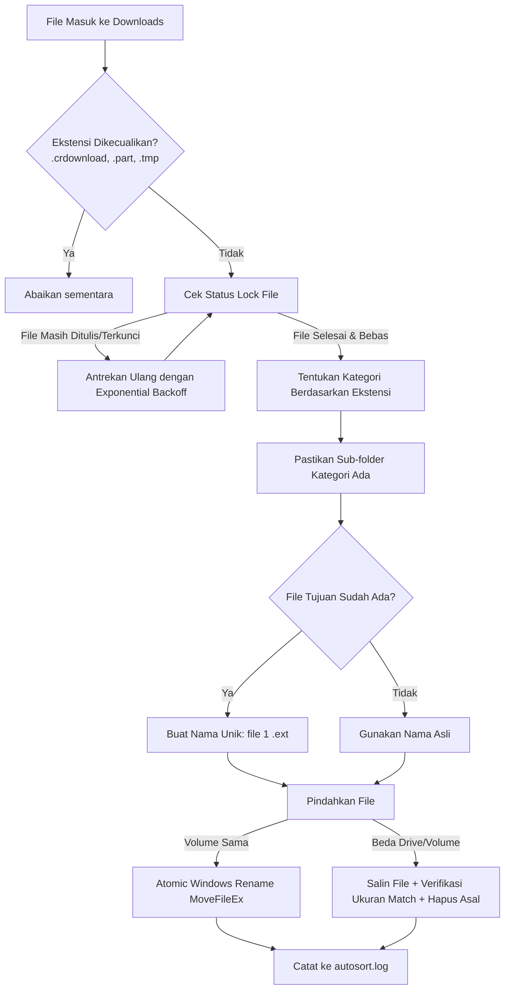

<div align="center">

# ⚡ WinAutoSort

**A blazing-fast, lightweight, and resilient background file router for Windows.**

[](https://golang.org)
[](https://microsoft.com/windows)
[](#-performance--benchmarks)
[](#-performance--benchmarks)
[](LICENSE)

*WinAutoSort monitors your target directory (e.g. `Downloads`) in real-time using Windows OS-level file system events (`fsnotify`), ensures active downloads are 100% finished, and instantly routes files into designated category folders with zero console popups.*

---

</div>

## 📑 Daftar Isi / Table of Contents
- [✨ Fitur Utama (Features)](#-fitur-utama-features)
- [🛡️ Keamanan & Anti Data-Loss](#️-keamanan--anti-data-loss)
- [📁 Kategori File Bawaan (Default Categories)](#-kategori-file-bawaan-default-categories)
- [🚀 Panduan Memulai Cepat (Quick Start)](#-panduan-memulai-cepat-quick-start)
- [⚙️ Pengaturan & Konfigurasi (config.json)](#️-pengaturan--konfigurasi-configjson)
- [🔄 Auto-Start saat Windows Boot (Startup)](#-auto-start-saat-windows-boot-startup)
- [🧪 Menjalankan Pengujian (Tests)](#-menjalankan-pengujian-tests)
- [📊 Performa & Resource](#-performa--resource)

---

## ✨ Fitur Utama (Features)

- **⚡ Real-time Event-Driven:** Memanfaatkan API Windows filesystem listener (`ReadDirectoryChangesW` via `fsnotify`), bukan polling loop berulang yang memboroskan baterai & CPU.
- **🔒 Smart Lock Detection:** Mendeteksi file yang masih dalam proses unduh browser (mengabaikan ekstensi sementara seperti `.crdownload`, `.part`, `.tmp`) dan menunggu lock file dilepas sebelum dipindahkan.
- **🔇 Silent Background Daemon:** Dikompilasi dengan `-ldflags "-H=windowsgui"` sehingga berjalan senyap di background tanpa ada jendela Command Prompt atau terminal yang mengganggu.
- **🛑 Single-Instance Guard:** Menggunakan Windows Named Kernel Mutex (`Local\WinAutoSort-...`) agar aplikasi tidak bisa berjalan dobel saat autostart dan manual klik bersamaan.
- **🛡️ Anti-Overwrite & Non-Destructive:** Jika nama file tujuan sudah ada, otomatis menambahkan penomoran `file (1).ext`. File lama tidak akan pernah tertimpa.
- **🧹 Setup Wizard Otomatis:** Saat pertama kali dijalankan, muncul dialog pertanyaan apakah ingin menyapu file lama yang sudah ada (*sweep on start*).

---

## 🛡️ Keamanan & Anti Data-Loss

WinAutoSort dirancang dengan prinsip **ketahanan data maksimal**:



1. **Atomic Rename:** Pemindahan dalam partisi yang sama menggunakan `MoveFileEx` tanpa overwrite.
2. **Verified Fallback:** Pemindahan lintas drive menyalin data terlebih dahulu, memverifikasi kesesuaian byte & checksum, lalu menghapus file asli. Jika copy gagal atau disk penuh, file asli **tidak pernah dihapus**.
3. **Panic & Crash Recovery:** Setiap worker goroutine dilengkapi `recover()` sehingga jika ada file yang korup, proses utama tetap berjalan.
4. **Self-Rotating Logs:** File `autosort.log` otomatis dirotasi jika melebihi ukuran 1 MB (dicadangkan ke `autosort.log.old`).

---

## 📁 Kategori File Bawaan (Default Categories)

Semua file dikelompokkan secara cerdas ke dalam sub-folder berikut:

| Nama Sub-folder | Jenis File & Ekstensi |
|---|---|
| `📂 image_download` | `.jpg`, `.jpeg`, `.png`, `.gif`, `.webp`, `.bmp`, `.tiff`, `.ico`, `.heic`, `.svg`, `.raw`, `.cr2`, `.nef`, `.dng` |
| `📂 video_download` | `.mp4`, `.mkv`, `.webm`, `.avi`, `.mov`, `.wmv`, `.flv`, `.3gp`, subtitle (`.srt`, `.vtt`, `.ass`) |
| `📂 audio_download` | `.mp3`, `.wav`, `.flac`, `.aac`, `.m4a`, `.ogg`, `.opus`, `.wma`, `.aiff`, `.mid` |
| `📂 document_download` | `.pdf`, `.doc`, `.docx`, `.odt`, `.rtf`, `.txt`, `.md`, `.xls`, `.xlsx`, `.csv`, `.ppt`, `.pptx` |
| `📂 ebook_download` | `.epub`, `.mobi`, `.azw`, `.azw3`, `.fb2`, `.djvu`, `.cbz`, `.cbr` |
| `📂 archive_download` | `.zip`, `.rar`, `.7z`, `.tar`, `.gz`, `.tgz`, `.bz2`, `.xz`, `.zst`, `.cab` |
| `📂 installer_download` | `.exe`, `.msi`, `.msix`, `.apk`, `.deb`, `.rpm`, `.dmg`, `.pkg`, `.appimage`, `.jar` |
| `📂 disk_image_download` | `.iso`, `.img`, `.vhd`, `.vhdx`, `.vmdk`, `.vdi`, `.wim` |
| `📂 font_download` | `.ttf`, `.otf`, `.woff`, `.woff2`, `.ttc` |
| `📂 design_download` | `.psd`, `.ai`, `.eps`, `.indd`, `.fig`, `.xd`, `.blend`, `.fbx`, `.obj`, `.stl`, `.dwg`, `.dxf` |
| `📂 code_download` | `.py`, `.js`, `.ts`, `.java`, `.cpp`, `.cs`, `.go`, `.rs`, `.html`, `.css`, `.json`, `.sql`, `.sh`, `.bat`, `.ps1` |
| `📂 data_download` | `.db`, `.sqlite`, `.sqlite3`, `.mdb`, `.accdb`, `.parquet`, `.bak` |
| `📂 file_download` | *Fallback otomatis* untuk file lainnya (misal file tanpa ekstensi, `.torrent`, `.lnk`) |

---

## 🚀 Panduan Memulai Cepat (Quick Start)

### 1. Prasyarat
- OS: Windows 10 atau Windows 11
- Go 1.23 atau lebih baru

### 2. Kompilasi Executable

```powershell
# Clone repositori
git clone https://github.com/USERNAME/winautosort.git
cd winautosort

# Unduh dependensi
go mod tidy

# Build untuk mode Background (Senyap tanpa terminal)
go build -ldflags "-H=windowsgui -s -w" -o WinAutoSort.exe .

# ATAU build untuk mode Debug (dengan output konsol untuk pengujian)
go build -o WinAutoSort-debug.exe .
```

### 3. Menjalankan Aplikasi
Cukup klik ganda pada `WinAutoSort.exe`. Pada pertama kali dijalankan, aplikasi akan menampilkan dialog setup awal.

---

## ⚙️ Pengaturan & Konfigurasi (config.json)

File `config.json` berada di samping file `WinAutoSort.exe`:

```json
{
  "watch_directory": "%USERPROFILE%\\Downloads",
  "rules": [
    {
      "category": "image_download",
      "extensions": [".jpg", ".png", ".webp", ".gif", ".heic"]
    }
  ],
  "default_fallback": "file_download",
  "exclude_extensions": [".crdownload", ".part", ".tmp"],
  "sweep_on_start": null,
  "lock_timeout_seconds": 7200,
  "max_workers": 4
}
```

### Penjelasan Opsi:
* `"watch_directory"`: Lokasi folder yang dipantau (mendukung variabel lingkungan `%USERPROFILE%` atau `%USERNAME%`).
* `"sweep_on_start"`: 
  * `null`: Memunculkan dialog pertanyaan saat startup.
  * `true`: Langsung merapikan semua file lama setiap kali aplikasi dibuka.
  * `false`: Hanya memproses file baru yang diunduh setelah aplikasi aktif.
* `"lock_timeout_seconds"`: Batas maksimum menunggu file yang sedang ditulis (default: 7200 detik / 2 jam).
* `"max_workers"`: Jumlah thread worker pemrosesan file paralel (default: 4, maksimal: 64).

> 💡 **Tips:** Untuk memunculkan kembali dialog pengaturan awal kapan saja, jalankan:
> ```powershell
> .\WinAutoSort.exe --setup
> ```

---

## 🔄 Auto-Start saat Windows Boot (Startup)

Agar WinAutoSort otomatis berjalan di latar belakang setiap kali Anda login ke Windows:

1. Tekan tombol `Win + R` di keyboard.
2. Ketik `shell:startup` lalu tekan **Enter** (folder Startup Windows akan terbuka).
3. Klik kanan di dalam folder tersebut $\rightarrow$ pilih **New** $\rightarrow$ **Shortcut**.
4. Arahkan ke file `WinAutoSort.exe` yang sudah Anda compile.
5. Selesai! WinAutoSort akan selalu otomatis aktif menjaga folder Downloads Anda.

> Untuk menghentikan aplikasi, buka **Task Manager** (`Ctrl + Shift + Esc`) $\rightarrow$ cari `WinAutoSort.exe` $\rightarrow$ klik **End Task**.

---

## 🧪 Menjalankan Pengujian (Tests)

Proyek ini dilengkapi dengan unit test dan integration test komprehensif (32 skenario pengujian):

```powershell
go test -v ./...
```

Pengujian mencakup:
- ✅ *Rule parsing & Windows environment variable expansion*
- ✅ *Smart file lock & release detection*
- ✅ *Collision resolution (`file (1).ext`)*
- ✅ *Simulation of browser `.crdownload` renaming lifecycle*
- ✅ *Single-instance named mutex collision guard*
- ✅ *Large batch processing (400 files concurrency test)*
- ✅ *Worker panic recovery resilience*

---

## 📊 Performa & Resource

| Metrik | Hasil Pengujian |
|---|---|
| **Penggunaan RAM** | ~12.5 MB - 13.5 MB |
| **Penggunaan CPU saat Idle** | **0.0%** (Event-driven OS interrupt) |
| **Latency Deteksi File** | < 100 milidetik |
| **Ukuran Executable** | ~3.4 MB (strip debug symbols `-s -w`) |

---

## 📄 Lisensi (License)

Proyek ini dilisensikan di bawah lisensi [MIT License](LICENSE).
Bebas digunakan, dimodifikasi, dan didistribusikan.
